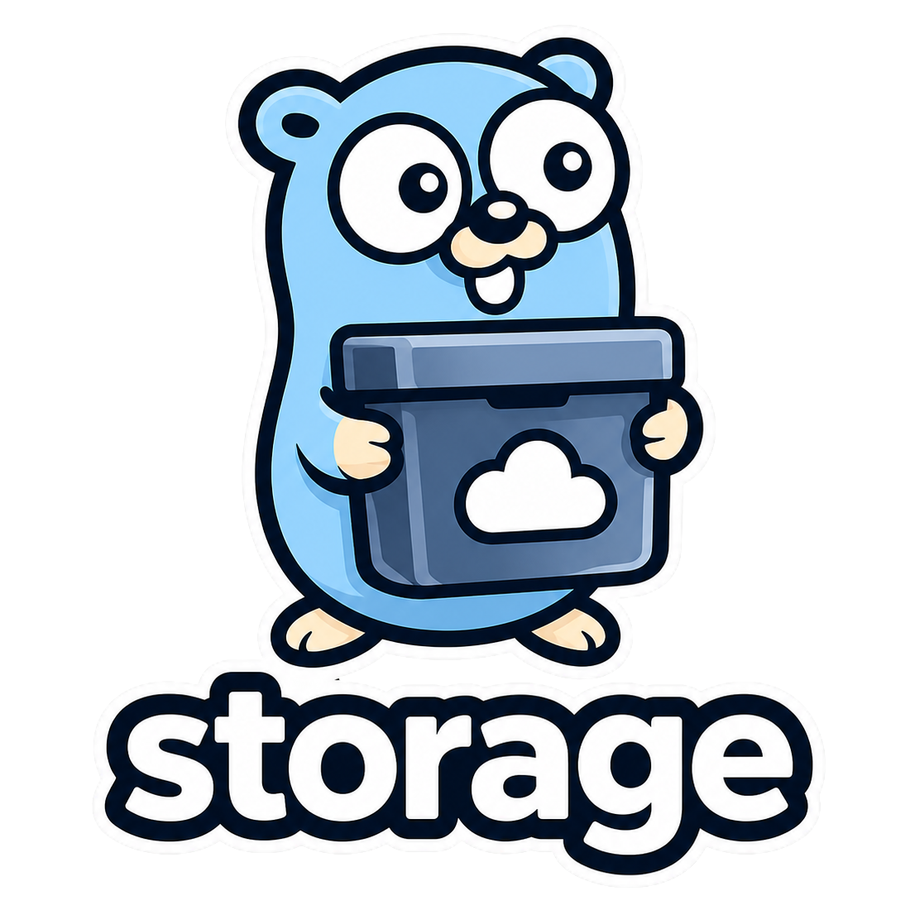

<p align="center">
  
</p>

<p align="center">
  One Go API for local files, S3, SFTP, and more.
</p>

<p align="center">
  <a href="https://pkg.go.dev/github.com/goforj/storage"></a>
  <a href="LICENSE"></a>
  <a href="https://github.com/goforj/storage/actions/workflows/ci.yml"></a>
  <a href="https://golang.org"></a>
  <a href="https://codecov.io/gh/goforj/storage"></a>
  
</p>

Give backups, uploads, and assets their own named disks. Each disk picks its
driver through a typed Go config. Your application uses the same calls to copy,
walk, and restore files.

## Quickstart

From your Go project, add Storage and the local filesystem driver. The local
driver requires Go 1.25.0 or newer.

```sh
go get github.com/goforj/storage github.com/goforj/storage/driver/localstorage
```

```go
package main

import (
    "context"
    "fmt"
    "log"
    "time"

    "github.com/goforj/storage"
    "github.com/goforj/storage/driver/localstorage"
)

func main() {
    // Open a local disk rooted at ./data. Switching drivers only changes this setup.
    disk, err := storage.Build(localstorage.Config{Root: "./data"})
    if err != nil {
        log.Fatal(err)
    }

    // Give the write and read one deadline so a slow backend can't keep us waiting indefinitely.
    ctx, cancel := context.WithTimeout(context.Background(), 5*time.Second)
    defer cancel()
    disk = disk.WithContext(ctx)

    // Use a path relative to the disk root for both the write and the read.
    if err := disk.Put("notes/hello.txt", []byte("hello from storage")); err != nil {
        log.Fatal(err)
    }
    body, err := disk.Get("notes/hello.txt")
    if err != nil {
        log.Fatal(err)
    }
    fmt.Println(string(body))
    // Output: hello from storage
}
```

## Driver Matrix

Install the driver modules you use. Each driver has its own dependencies and
minimum Go version.

| Driver | Use it for |
| ---: | --- |
| <a href="https://pkg.go.dev/github.com/goforj/storage/driver/localstorage"></a> | Files on a local or mounted filesystem |
| <a href="https://pkg.go.dev/github.com/goforj/storage/driver/memorystorage"></a> | In-process storage and application tests |
| <a href="https://pkg.go.dev/github.com/goforj/storage/driver/redisstorage"></a> | Small blobs shared across processes |
| <a href="https://pkg.go.dev/github.com/goforj/storage/driver/ftpstorage"></a> | Existing FTP servers |
| <a href="https://pkg.go.dev/github.com/goforj/storage/driver/sftpstorage"></a> | File transfers over SSH |
| <a href="https://pkg.go.dev/github.com/goforj/storage/driver/s3storage"></a> | Amazon S3 and compatible stores such as RustFS |
| <a href="https://pkg.go.dev/github.com/goforj/storage/driver/gcsstorage"></a> | Google Cloud Storage buckets |
| <a href="https://pkg.go.dev/github.com/goforj/storage/driver/dropboxstorage"></a> | Dropbox files and temporary access links |
| <a href="https://pkg.go.dev/github.com/goforj/storage/driver/rclonestorage"></a> | Any [Rclone remote](https://rclone.org/overview/), subject to its capabilities |

## Capability Matrix

### File transfers

| Driver | Read and write API | File copy | File move |
| ---: | --- | --- | --- |
|  | Byte slices | Streamed, atomic replace | Native rename |
|  | Byte slices | In-memory clone | Atomic rekey |
|  | Byte slices | Whole value, transactional | Transactional |
|  | Byte slices | Streamed, staged upload | Server rename |
|  | Byte slices | Streamed, atomic replace | POSIX rename |
|  | Byte slices or `storage.Objects` streams | Server-side, preserves metadata | Copy, then ETag-checked delete |
|  | Byte slices | Server-side, preserves metadata | Copy, then generation-checked delete |
|  | Byte slices | Buffered download and upload | Provider move |
|  | Byte slices | Provider-native or streamed | Copy, then delete |

<a id="directories-and-access"></a>

<details>
<summary>Directory operations, access URLs, and driver verification</summary>

| Driver | Directory model | Directory delete | Directory move | Access URL | Verification |
| ---: | --- | --- | --- | --- | --- |
|  | Filesystem | Empty only | Native rename | Unsupported | Temporary directory |
|  | In-memory entries | Empty only | Copy, then content-checked delete | Unsupported | In-process |
|  | Indexed directories | Empty only | Copy, then revision-checked delete | Unsupported | Redis container |
|  | Server directories | Empty only | Server rename | Unsupported | Embedded FTP |
|  | Server directories | Empty only | POSIX rename | Unsupported | SFTP container with host-key verification |
|  | Prefixes and markers | Empty marker only | Copy, then ETag-checked delete | Signed GET, 15 min | RustFS and SDK fixtures |
|  | Prefixes and markers | Empty marker only | Copy, then generation-checked delete | Signed GET, 15 min on GCS | GCS emulator |
|  | Provider folders | Unsupported | Provider move | Temporary file link | SDK fakes |
|  | Remote-dependent | Empty only, remote-dependent | Copy, then content-checked delete | Remote-dependent | Local contract and fake S3 tests |

All drivers provide `Stat`, `Exists`, `List`, `ListPage`, and `Walk` for logical paths.

FTP uploads write directly by default, so an interrupted upload can leave a
partial file at its destination. Enable `ftpstorage.Config.StagedWrites`
to upload to a sibling temporary file and publish by rename. That mode requires
rename permission and server support for replacing an existing file. FTP copies
always stage uploads and require two concurrent sessions. If the server rejects
a rename, the existing destination stays in place.

Cancel active SFTP writes and allow them to finish cleanup before closing the
disk when practical. Closing the disk also closes its connections. An interrupted
staged write can leave a `.storage-tmp-` file if cleanup cannot reach the server.

Offset-based `ListPage` generally fetches the complete listing before selecting
a window. Each call reads the current listing. Use `WalkObjectsContext` to process
S3 objects one provider page at a time.

Reserve the destination namespace for an emulated directory move. Rclone moves
also require exclusive source writes. Rclone's directory cleanup compares
source bytes and deletes in separate operations. When checked cleanup detects
a change, it returns `ErrConflict` and preserves the changed source. Once source
deletion starts, an error can leave the completed destination and some source
entries for reconciliation.

S3 copy uses the provider's single-request `CopyObject` operation. Its limits
depend on the provider. Amazon S3 allows up to 5 GB per object for a single
[CopyObject request](https://docs.aws.amazon.com/AmazonS3/latest/API/API_CopyObject.html).

</details>

## Install

Add the root module and the driver you plan to use. This example adds S3.

```sh
go get github.com/goforj/storage github.com/goforj/storage/driver/s3storage
```

## Go compatibility

| Modules | Minimum Go version |
| --- | --- |
| Root, storagecore, FTP, memory, and S3 | 1.24.4 |
| Dropbox and local storage | 1.25.0 |
| GCS, Rclone, Redis, SFTP, storagetest, examples, integration, and benchmarks | 1.26.0 |

## Usage

<a id="manager-and-named-disks"></a>

| When you need | Use |
| --- | --- |
| One disk | [`storage.Build(cfg)`](#build) |
| Several named disks | [`storage.New(cfg)`](#new) and [`manager.Disk(name)`](#manager-disk). See the [backup example](examples/backup/README.md). |
| Cancellation or a deadline for disk operations | [`disk.WithContext(ctx)`](#storage-withcontext) |

At shutdown, call [`manager.Close()`](#manager-close). Close standalone disks that implement `io.Closer`.

<details>
<summary>Setup context and direct driver handles</summary>

Use [`storage.BuildContext(ctx, cfg)`](#buildcontext) to pass a context during
disk setup. If you call a driver's `New(cfg)` directly, use
`storagecore.ContextStorage` for its context-aware operations.

</details>

### Streaming objects

Get the S3 streaming API with [`storage.Objects(disk)`](#objects). Pass a context
to each call.

- **Download** with `OpenObjectContext`. Close the returned reader.
- **Upload** with `PutObjectContext`. Pass a reader and its exact byte count.
- **List** with `WalkObjectsContext`. It visits objects one page at a time.

<details>
<summary>S3 streaming details</summary>

- **Keys** are relative to the disk prefix and preserve dot segments and repeated slashes.
- **Reads** can be pinned to an object version or ETag.
- **Uploads** accept optional metadata. The caller owns the reader. Use a seekable reader so the SDK can retry.
- **Checksums** are supported for non-seekable uploads over HTTPS. Over plain HTTP, non-empty uploads with non-seekable readers require `s3storage.Config.UnsignedPayload`, which also skips optional SDK checksum precomputation.
- **Cancellation** stops subsequent reads, including SDK prehashing. A reader blocked in `Read` must honor cancellation or be unblocked by its owner.
- **Driver support** is listed in the [capability matrix](#capability-matrix). Unsupported drivers return `storage.ErrUnsupported`. For a direct driver handle, call `storagecore.Objects(disk)`.

</details>

### Rclone

Use [`rclonestorage.New`](#rclonestorage-new) to open an Rclone remote. All
Rclone disks in a process share one config. Define your remotes together and
select each by name. Rclone 1.76 blocks HTTPS-to-HTTP redirects by default.

### Testing with fakes

Use `storagetest.Fake(t)` for a fresh in-memory disk or
`storagetest.FakeManager` to exercise named disks. Inject the same
`storage.Storage` interface your application uses.

## Benchmarks

Reading an 8 MiB object from RustFS with the S3 streaming API allocated about
**31 KiB**, down from **20 MiB** with `Get`. See the
[benchmark results](docs/bench/README.md) for copy timings, the local Rclone
tradeoff, and how to reproduce the measurements.

The [100 GB transfer run](examples/transfer/README.md#recorded-run) verified
100 GB in each direction per fixture across eight fixtures, with a SHA-256
check on every object.

<!-- bench:embed:start -->

**8 MiB copy on local benchmark fixtures**

| Fixture | ms/op | KiB allocated/op | Allocations/op |
| --- | ---: | ---: | ---: |
| local | 8.851 | 35.9 | 89.1 |
| memory | 0.289 | 8192.6 | 11.0 |
| rclone_local | 11.668 | 75.5 | 146.4 |
| ftp | 2.770 | 100.1 | 422.1 |
| sftp | 85.930 | 19702.5 | 6542.2 |
| redis | 5.794 | 8211.6 | 241.0 |
| gcs | 12.036 | 16791.0 | 1208.4 |
| s3 | 32.221 | 78.6 | 934.4 |
| rclone_s3 | 67.041 | 126.9 | 1573.0 |

<details>
<summary>Latency, allocated bytes, allocations, and iteration charts</summary>


</details>
<!-- bench:embed:end -->

## Migration notes

- Replace calls to a driver's `NewContext(ctx, cfg)` with
  [`storage.BuildContext(ctx, cfg)`](#buildcontext). Bind a request context to
  operations with `disk.WithContext(requestCtx)`.
- See the per-module Go compatibility table above. Local replacement is confined to the configured root on supported platforms.
- Redis clients sharing a database and prefix require a coordinated cutover: stop all clients before upgrading them together because older releases cannot read or validate new v2 index writes.
- SFTP configurations must provide `KnownHostsPath` unless `InsecureIgnoreHostKey` is explicitly enabled. The insecure option should be limited to controlled test environments.
- Dropbox `Delete` supports files only and uses revision-conditional deletion. Directory deletion returns `storage.ErrUnsupported` because recursive `DeleteV2` could otherwise remove children created after an empty-directory preflight.
- Empty and root-like paths identify a disk's logical root; the root cannot be mutated or aliased as an object by `Put`, `Delete`, `Copy`, or `Move`.
- Resource-backed disks should be closed when they implement `interface{ Close() error }`. Always call `Manager.Close()` when a manager is no longer needed so its initialized disks are released.

## API reference

The API section below is autogenerated; do not edit between the markers.

<!-- api:embed:start -->

## API Index

| Group | Functions |
|------:|-----------|
| **Config** | [rclonestorage.LocalRemote](#rclonestorage-localremote) · [rclonestorage.MustRenderLocal](#rclonestorage-mustrenderlocal) · [rclonestorage.MustRenderS3](#rclonestorage-mustrenders3) · [rclonestorage.RenderLocal](#rclonestorage-renderlocal) · [rclonestorage.RenderS3](#rclonestorage-renders3) · [rclonestorage.S3Remote](#rclonestorage-s3remote) |
| **Construction** | [Build](#build) · [DriverConfig](#driverconfig) · [DriverFactory](#driverfactory) · [ResolvedConfig](#resolvedconfig) · [s3storage.PrepareBucketContext](#s3storage-preparebucketcontext) |
| **Context** | [BuildContext](#buildcontext) · [CountFilesContext](#countfilescontext) |
| **Core** | [CountFiles](#countfiles) · [DiskName](#diskname) · [Entry](#entry) · [ListPageResult](#listpageresult) · [PagedStorage](#pagedstorage) · [PagedStorage.ListPage](#pagedstorage-listpage) · [PaginateEntries](#paginateentries) · [Storage](#storage) · [Storage.Copy](#storage-copy) · [Storage.Delete](#storage-delete) · [Storage.Exists](#storage-exists) · [Storage.Get](#storage-get) · [Storage.List](#storage-list) · [Storage.MakeDir](#storage-makedir) · [Storage.Move](#storage-move) · [Storage.Put](#storage-put) · [Storage.Stat](#storage-stat) · [Storage.URL](#storage-url) · [Storage.Walk](#storage-walk) · [Storage.WithContext](#storage-withcontext) |
| **Driver Config** | [Config.DriverName](#config-drivername) · [Config.ResolvedConfig](#config-resolvedconfig) · [dropboxstorage.Config](#dropboxstorage-config) · [ftpstorage.Config](#ftpstorage-config) · [gcsstorage.Config](#gcsstorage-config) · [localstorage.Config](#localstorage-config) · [memorystorage.Config](#memorystorage-config) · [rclonestorage.Config](#rclonestorage-config) · [redisstorage.Config](#redisstorage-config) · [s3storage.Config](#s3storage-config) · [sftpstorage.Config](#sftpstorage-config) |
| **Driver Constructors** | [dropboxstorage.New](#dropboxstorage-new) · [ftpstorage.New](#ftpstorage-new) · [gcsstorage.New](#gcsstorage-new) · [localstorage.New](#localstorage-new) · [memorystorage.New](#memorystorage-new) · [rclonestorage.New](#rclonestorage-new) · [redisstorage.New](#redisstorage-new) · [s3storage.New](#s3storage-new) · [sftpstorage.New](#sftpstorage-new) |
| **Manager** | [Config](#config) · [Manager](#manager) · [Manager.Close](#manager-close) · [Manager.Default](#manager-default) · [Manager.Disk](#manager-disk) · [New](#new) · [RegisterDriver](#registerdriver) |
| **Paths** | [JoinPrefix](#joinprefix) · [NormalizePath](#normalizepath) |
| **Streaming** | [Objects](#objects) |


## Config

### <a id="rclonestorage-localremote"></a>rclonestorage.LocalRemote

LocalRemote defines a local backend configuration.

_Example: define a local remote_

```go
remote := rclonestorage.LocalRemote{Name: "local"}
fmt.Println(remote.Name)
// Output: local
```

_Example: define a local remote with all fields_

```go
remote := rclonestorage.LocalRemote{
	Name: "local",
}
fmt.Println(remote.Name)
// Output: local
```

### <a id="rclonestorage-mustrenderlocal"></a>rclonestorage.MustRenderLocal

MustRenderLocal panics on error.

```go
cfg := rclonestorage.MustRenderLocal(rclonestorage.LocalRemote{Name: "local"})
fmt.Println(cfg)
// Output:
// [local]
// type = local
```

### <a id="rclonestorage-mustrenders3"></a>rclonestorage.MustRenderS3

MustRenderS3 panics on error.

```go
cfg := rclonestorage.MustRenderS3(rclonestorage.S3Remote{
	Name:            "assets",
	Region:          "us-east-1",
	AccessKeyID:     "key",
	SecretAccessKey: "secret",
})
fmt.Println(cfg)
// Output:
// [assets]
// type = s3
// provider = AWS
// access_key_id = key
// secret_access_key = secret
// region = us-east-1
```

### <a id="rclonestorage-renderlocal"></a>rclonestorage.RenderLocal

RenderLocal returns ini-formatted rclone config for a local backend.

```go
cfg, _ := rclonestorage.RenderLocal(rclonestorage.LocalRemote{Name: "local"})
fmt.Println(cfg)
// Output:
// [local]
// type = local
```

### <a id="rclonestorage-renders3"></a>rclonestorage.RenderS3

RenderS3 returns ini-formatted rclone config content for a single S3 remote.

```go
cfg, _ := rclonestorage.RenderS3(rclonestorage.S3Remote{
	Name:            "assets",
	Region:          "us-east-1",
	AccessKeyID:     "key",
	SecretAccessKey: "secret",
})
fmt.Println(cfg)
// Output:
// [assets]
// type = s3
// provider = AWS
// access_key_id = key
// secret_access_key = secret
// region = us-east-1
```

### <a id="rclonestorage-s3remote"></a>rclonestorage.S3Remote

S3Remote defines parameters for constructing an rclone S3 remote.

_Example: define an s3 remote_

```go
remote := rclonestorage.S3Remote{
	Name:            "assets",
	Region:          "us-east-1",
	AccessKeyID:     "key",
	SecretAccessKey: "secret",
}
fmt.Println(remote.Name)
// Output: assets
```

_Example: define an s3 remote with all fields_

```go
remote := rclonestorage.S3Remote{
	Name:               "assets",
	Endpoint:           "http://localhost:9000", // default: ""
	Region:             "us-east-1",
	AccessKeyID:        "key",
	SecretAccessKey:    "secret",
	Provider:           "AWS",    // default: "AWS"
	PathStyle:          false,    // default: false
	BucketACL:          "private", // default: ""
	UseUnsignedPayload: false,    // default: false
}
fmt.Println(remote.Name)
// Output: assets
```

## Construction

### <a id="build"></a>Build

Build constructs a single storage backend from a typed driver config without
a Manager.

```go
fs, _ := storage.Build(localstorage.Config{
	Root: "/tmp/storage-example",
	Prefix: "assets",
})
```

### <a id="driverconfig"></a>DriverConfig

DriverConfig is implemented by typed driver configs such as local.Config or
s3storage.Config. It is the public config boundary for Manager and Build.

```go
var cfg storage.DriverConfig = localstorage.Config{
	Root: "/tmp/storage-config",
}
```

### <a id="driverfactory"></a>DriverFactory

DriverFactory constructs a Storage for a given normalized disk configuration.

```go
factory := storage.DriverFactory(func(ctx context.Context, cfg storage.ResolvedConfig) (storage.Storage, error) {
	return nil, nil
})
```

### <a id="resolvedconfig"></a>ResolvedConfig

ResolvedConfig is the normalized internal config passed to registered drivers.
Users should prefer typed driver configs and treat this as registry adapter
glue, not the primary construction API.

```go
factory := storage.DriverFactory(func(ctx context.Context, cfg storage.ResolvedConfig) (storage.Storage, error) {
	fmt.Println(cfg.Driver)
	// Output: memory
	return nil, nil
})

_, _ = factory(context.Background(), storage.ResolvedConfig{Driver: "memory"})
```

### <a id="s3storage-preparebucketcontext"></a>s3storage.PrepareBucketContext

PrepareBucketContext creates a missing bucket using the same configuration and credentials as the driver.
Existing buckets are unchanged. Permission failures never trigger a creation attempt.

```go
// Start the backup demo's RustFS container before running this example.
ctx, cancel := context.WithTimeout(context.Background(), 10*time.Second)
defer cancel()

cfg := s3storage.Config{
	Bucket:          "storage-demo",
	Region:          "us-east-1",
	Endpoint:        "http://127.0.0.1:19000",
	UsePathStyle:    true,
	AccessKeyID:     "storage-demo",
	SecretAccessKey: "storage-demo-password",
}
if err := s3storage.PrepareBucketContext(ctx, cfg); err != nil {
	panic(err)
}
fmt.Println("bucket ready")
// Output: bucket ready
```

## Context

### <a id="buildcontext"></a>BuildContext

BuildContext constructs a single storage backend from a typed driver config
using the caller-provided context.

```go
ctx, cancel := context.WithCancel(context.Background())
cancel()
_, err := storage.BuildContext(ctx, memorystorage.Config{})
fmt.Println(errors.Is(err, context.Canceled))
// Output: true
```

### <a id="countfilescontext"></a>CountFilesContext

CountFilesContext returns the recursive count of non-directory entries under
path using the caller-provided context.

```go
disk, _ := storage.Build(memorystorage.Config{})
_ = disk.Put("docs/readme.txt", []byte("hello"))
ctx, cancel := context.WithTimeout(context.Background(), time.Second)
defer cancel()
total, err := storage.CountFilesContext(ctx, disk, "docs")
if err != nil {
	panic(err)
}
fmt.Println(total)
// Output: 1
```

## Core

### <a id="countfiles"></a>CountFiles

CountFiles returns the recursive count of non-directory entries under path.

CountFiles uses Walk under the hood, so it works across drivers that support
recursive traversal.

```go
disk, _ := storage.Build(localstorage.Config{
	Root: "/tmp/storage-count-files",
})
_ = disk.MakeDir("docs/archive")
_ = disk.Put("docs/readme.txt", []byte("hello"))
_ = disk.Put("docs/archive/guide.txt", []byte("guide"))

total, _ := storage.CountFiles(disk, "docs")
fmt.Println(total)
// Output: 2
```

### <a id="diskname"></a>DiskName

DiskName is a typed identifier for configured disks.

```go
const uploads storage.DiskName = "uploads"
fmt.Println(uploads)
// Output: uploads
```

### <a id="entry"></a>Entry

Entry represents an item returned by List.

Path is relative to the storage namespace, not an OS-native path.
Directory-like entries are listing artifacts, not a promise of POSIX-style
storage semantics.

```go
entry := storage.Entry{
	Path:  "docs/readme.txt",
	Size:  5,
	IsDir: false,
}
fmt.Println(entry.Path, entry.IsDir)
// Output: docs/readme.txt false
```

### <a id="listpageresult"></a>ListPageResult

ListPageResult describes a paginated one-level directory listing.

```go
page := storage.ListPageResult{
	Entries: []storage.Entry{{Path: "notes.txt"}},
	Offset:  0,
	Limit:   1,
	HasMore: true,
}
if page.HasMore {
	fmt.Println("Next offset:", page.Offset+len(page.Entries))
	// Output: Next offset: 1
}
```

### <a id="pagedstorage"></a>PagedStorage

PagedStorage exposes paginated one-level listing when a backend can support it.
Use Storage for the common path and type-assert to PagedStorage when you need
backend-driven pagination.

```go
disk, _ := storage.Build(memorystorage.Config{})
_, ok := disk.(storage.PagedStorage)
fmt.Println("Pagination available:", ok)
// Output: Pagination available: true
```

### <a id="pagedstorage-listpage"></a>PagedStorage.ListPage

ListPage returns one page of immediate children under path.

```go
disk, _ := storage.Build(memorystorage.Config{})
_ = disk.Put("docs/a.txt", []byte("a"))
_ = disk.Put("docs/b.txt", []byte("b"))
paged, ok := disk.(storage.PagedStorage)
if !ok {
	panic("disk does not support pagination")
}
page, err := paged.ListPage("docs", 0, 1)
if err != nil {
	panic(err)
}
fmt.Println(page.Entries[0].Path, page.HasMore)
// Output: docs/a.txt true
```

### <a id="paginateentries"></a>PaginateEntries

PaginateEntries returns a clamped page without mutating the caller's entry slice.

```go
entries := []storage.Entry{{Path: "a.txt"}, {Path: "b.txt"}, {Path: "c.txt"}}
page := storage.PaginateEntries(entries, 1, 1)
fmt.Println(page.Entries[0].Path, page.HasMore)
// Output: b.txt true
```

### <a id="storage"></a>Storage

Storage is the public interface for interacting with a storage backend.

Semantics:
- Put overwrites an existing object at the same path.
- MakeDir creates a directory-like prefix and may be implemented as a
backend-specific directory marker on object stores.
- List is one-level, non-recursive, and sorted lexicographically by Path.
- List with an empty path lists from the disk root or prefix root.
- Walk visits entries recursively in deterministic, driver-specific order.
List and Walk reject backend names that cannot round-trip through the path API.
- URL returns a usable access URL when the driver supports it.
- Copy overwrites the destination object when the backend supports copy semantics.
- Move relocates an object or directory tree and may be implemented as copy followed by delete.
Directory moves roll back destination entries if copying fails. A failure while deleting
the source may leave a complete destination alongside the undeleted source remainder.
Reserve the destination for an emulated move. Some backends also require exclusive
access to the source because they cannot condition deletion on its original revision.
- Unsupported operations should return ErrUnsupported.

```go
var disk storage.Storage
disk, _ = storage.Build(localstorage.Config{
	Root: "/tmp/storage-interface",
})
```

### <a id="storage-copy"></a>Storage.Copy

Copy copies the object at src to dst.

```go
disk, _ := storage.Build(localstorage.Config{
	Root: "/tmp/storage-copy",
})
_ = disk.Put("docs/readme.txt", []byte("hello"))
_ = disk.Copy("docs/readme.txt", "docs/copy.txt")

data, _ := disk.Get("docs/copy.txt")
fmt.Println(string(data))
// Output: hello
```

### <a id="storage-delete"></a>Storage.Delete

Delete removes the object at path.

```go
disk, _ := storage.Build(localstorage.Config{
	Root: "/tmp/storage-delete",
})
_ = disk.Put("docs/readme.txt", []byte("hello"))
_ = disk.Delete("docs/readme.txt")

ok, _ := disk.Exists("docs/readme.txt")
fmt.Println(ok)
// Output: false
```

### <a id="storage-exists"></a>Storage.Exists

Exists reports whether an object exists at path.

```go
disk, _ := storage.Build(localstorage.Config{
	Root: "/tmp/storage-exists",
})
_ = disk.Put("docs/readme.txt", []byte("hello"))

ok, _ := disk.Exists("docs/readme.txt")
fmt.Println(ok)
// Output: true
```

### <a id="storage-get"></a>Storage.Get

Get reads the object at path.

```go
disk, _ := storage.Build(localstorage.Config{
	Root: "/tmp/storage-get",
})
_ = disk.Put("docs/readme.txt", []byte("hello"))

data, _ := disk.Get("docs/readme.txt")
fmt.Println(string(data))
// Output: hello
```

### <a id="storage-list"></a>Storage.List

List returns the immediate children under path.

```go
disk, _ := storage.Build(localstorage.Config{
	Root: "/tmp/storage-list",
})
_ = disk.Put("docs/readme.txt", []byte("hello"))

entries, _ := disk.List("docs")
fmt.Println(entries[0].Path)
// Output: docs/readme.txt
```

### <a id="storage-makedir"></a>Storage.MakeDir

MakeDir creates a directory-like entry at path.

```go
disk, _ := storage.Build(localstorage.Config{
	Root: "/tmp/storage-mkdir",
})
```

### <a id="storage-move"></a>Storage.Move

Move moves the object or directory tree at src to dst.

_Example: move an object_

```go
disk, _ := storage.Build(localstorage.Config{
	Root: "/tmp/storage-move",
})
_ = disk.Put("docs/readme.txt", []byte("hello"))
_ = disk.Move("docs/readme.txt", "docs/archive.txt")

ok, _ := disk.Exists("docs/readme.txt")
fmt.Println(ok)
// Output: false
```

_Example: move a directory tree_

```go
disk, _ := storage.Build(localstorage.Config{
	Root: "/tmp/storage-move-dir",
})
_ = disk.MakeDir("docs/archive")
_ = disk.Put("docs/archive/readme.txt", []byte("hello"))
_ = disk.Move("docs/archive", "docs/published")

entry, _ := disk.Stat("docs/published")
fmt.Println(entry.IsDir)
// Output: true
```

### <a id="storage-put"></a>Storage.Put

Put writes an object at path, overwriting any existing object.

```go
disk, _ := storage.Build(localstorage.Config{
	Root: "/tmp/storage-put",
})
_ = disk.Put("docs/readme.txt", []byte("hello"))
fmt.Println("stored")
// Output: stored
```

### <a id="storage-stat"></a>Storage.Stat

Stat returns the entry at path.

```go
disk, _ := storage.Build(localstorage.Config{
	Root: "/tmp/storage-stat",
})
_ = disk.Put("docs/readme.txt", []byte("hello"))

entry, _ := disk.Stat("docs/readme.txt")
fmt.Println(entry.Path, entry.Size)
// Output: docs/readme.txt 5
```

### <a id="storage-url"></a>Storage.URL

URL returns a usable access URL when the driver supports it.

_Example: request an object url_

```go
disk, _ := storage.Build(s3storage.Config{
	Bucket: "uploads",
	Region: "us-east-1",
})

url, _ := disk.URL("docs/readme.txt")
```

_Example: handle unsupported url generation_

```go
disk, _ := storage.Build(localstorage.Config{
	Root: "/tmp/storage-url",
})

_, err := disk.URL("docs/readme.txt")
fmt.Println(errors.Is(err, storage.ErrUnsupported))
// Output: true
```

### <a id="storage-walk"></a>Storage.Walk

Walk visits entries recursively in deterministic path order.

```go
disk, _ := storage.Build(localstorage.Config{
	Root: "/tmp/storage-walk",
})
_ = disk.Put("docs/readme.txt", []byte("hello"))

err := disk.Walk("", func(entry storage.Entry) error {
	fmt.Println(entry.Path)
	return nil
})
fmt.Println(err == nil)
// Output:
// docs
// docs/readme.txt
// true
```

### <a id="storage-withcontext"></a>Storage.WithContext

WithContext returns a derived storage handle bound to ctx for subsequent operations.

```go
disk, _ := storage.Build(localstorage.Config{
	Root: "/tmp/storage-with-context",
})
_ = disk.Put("docs/readme.txt", []byte("hello"))

ctx, cancel := context.WithTimeout(context.Background(), time.Second)
defer cancel()

data, _ := disk.WithContext(ctx).Get("docs/readme.txt")
fmt.Println(string(data))
// Output: hello
```

## Driver Config

### <a id="config-drivername"></a>Config.DriverName

DriverName returns the registry name for local storage.

```go
cfg := localstorage.Config{Root: "./data"}
fmt.Println(cfg.DriverName())
// Output: local
```

### <a id="config-resolvedconfig"></a>Config.ResolvedConfig

ResolvedConfig translates Config into the shared driver boundary.

```go
cfg := localstorage.Config{Root: "./data", Prefix: "uploads"}
resolved := cfg.ResolvedConfig()
fmt.Println(resolved.Driver, resolved.Remote, resolved.Prefix)
// Output: local ./data uploads
```

### <a id="dropboxstorage-config"></a>dropboxstorage.Config

Config defines a Dropbox-backed storage disk.

_Example: define dropbox storage config_

```go
cfg := dropboxstorage.Config{
	Token: "token",
}
```

_Example: define dropbox storage config with all fields_

```go
cfg := dropboxstorage.Config{
	Token:  "token",
	Prefix: "uploads", // default: ""
}
```

### <a id="ftpstorage-config"></a>ftpstorage.Config

Config defines an FTP-backed storage disk.

_Example: define ftp storage config_

```go
cfg := ftpstorage.Config{
	Host:     "127.0.0.1",
	User:     "demo",
	Password: "secret",
}
```

_Example: define ftp storage config with all fields_

```go
cfg := ftpstorage.Config{
	Host:               "127.0.0.1",
	Port:               21,        // default: 21
	User:               "demo",    // default: ""
	Password:           "secret",  // default: ""
	StagedWrites:       false,     // default: false
	TLS:                false,     // default: false
	InsecureSkipVerify: false,     // default: false
	Prefix:             "uploads", // default: ""
}
```

### <a id="gcsstorage-config"></a>gcsstorage.Config

Config defines a GCS-backed storage disk.

_Example: define gcs storage config_

```go
cfg := gcsstorage.Config{
	Bucket: "uploads",
}
```

_Example: define gcs storage config with all fields_

```go
cfg := gcsstorage.Config{
	Bucket:          "uploads",
	CredentialsJSON: "{...}",              // default: ""
	Endpoint:        "http://127.0.0.1:0", // default: ""
	Prefix:          "assets",             // default: ""
}
```

### <a id="localstorage-config"></a>localstorage.Config

Config defines local storage rooted at a filesystem path.

_Example: define local storage config_

```go
cfg := localstorage.Config{
	Root:   "/tmp/storage-local",
	Prefix: "sandbox",
}
```

_Example: define local storage config with all fields_

```go
cfg := localstorage.Config{
	Root:   "/tmp/storage-local",
	Prefix: "sandbox", // default: ""
}
```

### <a id="memorystorage-config"></a>memorystorage.Config

Config defines an in-memory storage disk.

_Example: define memory storage config_

```go
cfg := memorystorage.Config{}
```

_Example: define memory storage config with all fields_

```go
cfg := memorystorage.Config{
	Prefix: "sandbox", // default: ""
}
```

### <a id="rclonestorage-config"></a>rclonestorage.Config

Config defines an rclone-backed storage disk.

_Example: define rclone storage config_

```go
cfg := rclonestorage.Config{
	Remote: "local:",
	Prefix: "sandbox",
}
```

_Example: define rclone storage config with all fields_

```go
cfg := rclonestorage.Config{
	Remote:           "local:",
	Prefix:           "sandbox",                  // default: ""
	RcloneConfigPath: "/path/to/rclone.conf",     // default: ""
	RcloneConfigData: "[local]\ntype = local\n",  // default: ""
}
```

### <a id="redisstorage-config"></a>redisstorage.Config

Config defines a Redis-backed storage disk for distributed temporary blobs.

_Example: define redis storage config_

```go
cfg := redisstorage.Config{
	Addr: "127.0.0.1:6379",
}
```

_Example: define redis storage config with all fields_

```go
cfg := redisstorage.Config{
	Addr:     "127.0.0.1:6379",
	Username: "",
	Password: "",
	DB:       0,
	Prefix:   "scratch", // default: ""
}
```

### <a id="s3storage-config"></a>s3storage.Config

Config defines an S3-backed storage disk.

_Example: define s3 storage config_

```go
cfg := s3storage.Config{
	Bucket: "uploads",
	Region: "us-east-1",
}
```

_Example: define s3 storage config with all fields_

```go
cfg := s3storage.Config{
	Bucket:          "storage-demo",
	Endpoint:        "http://localhost:19000", // default: ""
	Region:          "us-east-1",
	AccessKeyID:     "storage-demo",           // default: ""
	SecretAccessKey: "storage-demo-password",  // default: ""
	UsePathStyle:    true,                     // default: false
	UnsignedPayload: false,                    // default: false
	Prefix:          "assets",                 // default: ""
}
```

### <a id="sftpstorage-config"></a>sftpstorage.Config

Config defines an SFTP-backed storage disk.

_Example: define sftp storage config_

```go
cfg := sftpstorage.Config{
	Host:     "127.0.0.1",
	User:     "demo",
	Password: "secret",
}
```

_Example: define sftp storage config with all fields_

```go
cfg := sftpstorage.Config{
	Host:                  "127.0.0.1",
	Port:                  22,            // default: 22
	User:                  "demo",        // default: "root"
	Password:              "secret",      // default: ""
	KeyPath:               "/path/id_ed25519",      // default: ""
	KnownHostsPath:        "/path/known_hosts",     // default: ""
	InsecureIgnoreHostKey: false,         // default: false
	Prefix:                "uploads",     // default: ""
}
```

## Driver Constructors

### <a id="dropboxstorage-new"></a>dropboxstorage.New

New constructs Dropbox-backed storage using the official SDK.

```go
fs, _ := dropboxstorage.New(dropboxstorage.Config{
	Token: "token",
})
```

### <a id="ftpstorage-new"></a>ftpstorage.New

New constructs FTP-backed storage using jlaffaye/ftp.

```go
fs, _ := ftpstorage.New(ftpstorage.Config{
	Host:     "127.0.0.1",
	User:     "demo",
	Password: "secret",
})
```

### <a id="gcsstorage-new"></a>gcsstorage.New

New constructs GCS-backed storage using cloud.google.com/go/storage.

```go
fs, _ := gcsstorage.New(gcsstorage.Config{
	Bucket: "uploads",
})
```

### <a id="localstorage-new"></a>localstorage.New

New constructs local storage rooted at cfg.Root with an optional prefix.

```go
fs, _ := localstorage.New(localstorage.Config{
	Root:   "/tmp/storage-local",
	Prefix: "sandbox",
})
```

### <a id="memorystorage-new"></a>memorystorage.New

New constructs in-memory storage.

```go
fs, _ := memorystorage.New(memorystorage.Config{
	Prefix: "sandbox",
})
```

### <a id="rclonestorage-new"></a>rclonestorage.New

New constructs an rclone-backed storage. All disks share a single config path.

_Example: rclone storage_

```go
fs, _ := rclonestorage.New(rclonestorage.Config{
	Remote: "local:",
	Prefix: "sandbox",
})
```

_Example: rclone storage with inline config_

```go
fs, _ := rclonestorage.New(rclonestorage.Config{
	Remote: "localdisk:/tmp/storage",
	RcloneConfigData: `

[localdisk]
type = local
`,

})
```

### <a id="redisstorage-new"></a>redisstorage.New

New constructs Redis-backed storage using go-redis.

```go
fs, _ := redisstorage.New(redisstorage.Config{
	Addr:   "127.0.0.1:6379",
	Prefix: "scratch",
})
```

### <a id="s3storage-new"></a>s3storage.New

New constructs S3-backed storage using AWS SDK v2.

```go
fs, _ := s3storage.New(s3storage.Config{
	Bucket: "uploads",
	Region: "us-east-1",
})
```

### <a id="sftpstorage-new"></a>sftpstorage.New

New constructs SFTP-backed storage using ssh and pkg/sftp.

```go
fs, _ := sftpstorage.New(sftpstorage.Config{
	Host:     "127.0.0.1",
	User:     "demo",
	Password: "secret",
})
```

## Manager

### <a id="config"></a>Config

Config defines named disks using typed driver configs.

```go
cfg := storage.Config{
	Default: "local",
	Disks: map[storage.DiskName]storage.DriverConfig{
		"local": localstorage.Config{Root: "/tmp/storage-manager"},
	},
}
```

### <a id="manager"></a>Manager

Manager holds named storage disks.

```go
mgr, _ := storage.New(storage.Config{
	Default: "local",
	Disks: map[storage.DiskName]storage.DriverConfig{
		"local": localstorage.Config{Root: "/tmp/storage-manager"},
	},
})
```

### <a id="manager-close"></a>Manager.Close

Close releases all initialized disks once in reverse deterministic construction order.

```go
manager, err := storage.New(storage.Config{
	Default: "scratch",
	Disks: map[storage.DiskName]storage.DriverConfig{
		"scratch": memorystorage.Config{},
	},
})
if err != nil {
	panic(err)
}
if err := manager.Close(); err != nil {
	panic(err)
}
fmt.Println("storage closed")
// Output: storage closed
```

### <a id="manager-default"></a>Manager.Default

Default returns the default disk or panics if misconfigured.

```go
mgr, _ := storage.New(storage.Config{
	Default: "local",
	Disks: map[storage.DiskName]storage.DriverConfig{
		"local": localstorage.Config{Root: "/tmp/storage-default"},
	},
})

fs := mgr.Default()
fmt.Println(fs != nil)
// Output: true
```

### <a id="manager-disk"></a>Manager.Disk

Disk returns a named disk or an error if it does not exist.

```go
mgr, _ := storage.New(storage.Config{
	Default: "local",
	Disks: map[storage.DiskName]storage.DriverConfig{
		"local":   localstorage.Config{Root: "/tmp/storage-default"},
		"uploads": localstorage.Config{Root: "/tmp/storage-uploads"},
	},
})

fs, _ := mgr.Disk("uploads")
fmt.Println(fs != nil)
// Output: true
```

### <a id="new"></a>New

New constructs a Manager and eagerly initializes all disks.

```go
mgr, _ := storage.New(storage.Config{
	Default: "local",
	Disks: map[storage.DiskName]storage.DriverConfig{
		"local":  localstorage.Config{Root: "/tmp/storage-local"},
		"assets": localstorage.Config{Root: "/tmp/storage-assets", Prefix: "public"},
	},
})
```

### <a id="registerdriver"></a>RegisterDriver

RegisterDriver makes a driver available to the Manager. It panics on duplicate registrations.

```go
storage.RegisterDriver("memory", func(ctx context.Context, cfg storage.ResolvedConfig) (storage.Storage, error) {
	return nil, nil
})
```

## Paths

### <a id="joinprefix"></a>JoinPrefix

JoinPrefix combines a disk prefix with a path using slash separators.

```go
fmt.Println(storage.JoinPrefix("assets", "logo.svg"))
// Output: assets/logo.svg
```

### <a id="normalizepath"></a>NormalizePath

NormalizePath cleans a user path, normalizes separators, and rejects attempts
to escape the disk root or prefix root.

The empty string and root-like inputs normalize to the logical root.

```go
p, _ := storage.NormalizePath(" /avatars//user-1.png ")
fmt.Println(p)
// Output: avatars/user-1.png
```

## Streaming

### <a id="objects"></a>Objects

Objects returns a driver's streaming object capability. Each streaming call
takes its own context. Unsupported drivers return ErrUnsupported.

```go
// Run the RustFS backup demo first to create the bucket.
ctx := context.Background()
disk, err := storage.Build(s3storage.Config{
	Bucket:          "storage-demo",
	Region:          "us-east-1",
	Endpoint:        "http://127.0.0.1:19000",
	UsePathStyle:    true,
	AccessKeyID:     "storage-demo",
	SecretAccessKey: "storage-demo-password",
})
if err != nil {
	panic(err)
}
objects, err := storage.Objects(disk)
if err != nil {
	panic(err)
}
body := strings.NewReader("hello from storage")
info, err := objects.PutObjectContext(ctx, "stream.txt", body, storagecore.PutObjectOptions{
	Size: body.Size(),
})
if err != nil {
	panic(err)
}
fmt.Println(info.Key, info.Size)
// Output: stream.txt 18
```
<!-- api:embed:end -->

## Development

```sh
make test                         # Test the root module
make test-examples                # Test the examples module
make test-integration             # Test all driver fixtures with Docker
make test-integration gcs         # Test GCS with its emulator
make test-coverage                # Generate combined coverage
go run ./docs/readme/main.go      # Regenerate the API reference
make docs-watch                   # Regenerate docs and examples as code changes
```

Run `go test ./...` in each driver module you change. See `make help` for all
targets, the [test plan](TEST_PLAN.md) for fixture details, and the
[release runbook](scripts/RELEASE.md) for publishing.
